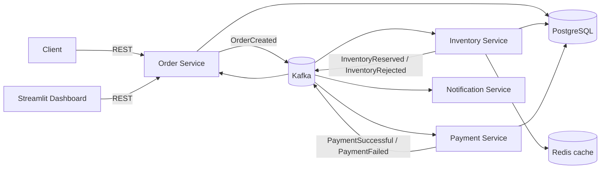

# Event-Driven Order Processing System

A beginner-friendly Java 21 and Spring Boot example of an e-commerce order flow. Four independently runnable services exchange JSON events through Kafka. PostgreSQL stores orders, products, and payments; Redis caches product reads; Streamlit reads order data only through the Order Service REST API.

## Architecture



Services own their application logic and tables. Docker Compose runs one PostgreSQL instance and one Redis instance for local development. PostgreSQL is the source of truth for stock; successful stock reservations update the product cache.

## Technology stack

- Java 21, Spring Boot, Spring Data JPA, Hibernate
- Apache Kafka with JSON event payloads
- PostgreSQL (host port `5433`) and Redis
- Streamlit and Python
- Maven and Docker Compose

## Service responsibilities

| Service | Responsibility | Local URL |
|---|---|---|
| Order Service | Create, retrieve, list, and update order status | `http://localhost:8081` |
| Inventory Service | Manage products, check stock, reserve inventory, cache product reads | `http://localhost:8082` |
| Payment Service | Randomly simulate payment results and persist them | `http://localhost:8083` |
| Notification Service | Log notifications for order and payment events | `http://localhost:8084` |
| Dashboard | Display order counts and order details using the Order API | `http://localhost:8501` |

## Database tables

- `orders`: order ID, customer ID, product ID, quantity, amount, status, timestamps
- `products`: product ID, name, available quantity
- `payments`: payment ID, order ID, amount, result, timestamp

For local development, the services use separate tables in the same PostgreSQL database. This keeps setup small; production deployments would normally give each service its own database.

## Kafka event flow

All event payloads are JSON and carry an event ID, order ID, and occurrence time, with additional fields relevant to the event.

1. Order Service saves an order as `CREATED` and publishes `OrderCreated` to `order-created`.
2. Inventory Service checks and reserves stock, then publishes `InventoryReserved` to `inventory-reserved` or `InventoryRejected` to `inventory-rejected`.
3. Payment Service consumes `inventory-reserved`, stores a simulated payment, and publishes either `PaymentSuccessful` to `payment-successful` or `PaymentFailed` to `payment-failed`.
4. Order Service consumes the result events and changes the order to `CONFIRMED` or `FAILED`.
5. Notification Service consumes order and outcome events and logs simulated notifications.

The five Kafka topics are `order-created`, `inventory-reserved`, `inventory-rejected`, `payment-successful`, and `payment-failed`.

## REST APIs

### Order Service

Create an order:

```http
POST /api/orders
Content-Type: application/json
```

```json
{
  "customerId": "customer-123",
  "productId": "d1f24fd3-8aed-4b8c-9124-fae48ec7a630",
  "quantity": 2,
  "amount": 39.98
}
```

- `GET /api/orders` — list orders
- `GET /api/orders/{orderId}` — retrieve one order

### Inventory Service

Create a product:

```http
POST /api/products
Content-Type: application/json
```

```json
{
  "name": "Example product",
  "availableQuantity": 10
}
```

- `GET /api/products` — list products
- `GET /api/products/{productId}` — retrieve a product

### Payment Service

- `GET /api/payments/orders/{orderId}` — retrieve a payment result

### Health

- `GET /actuator/health` — health status for each Spring Boot service
- `GET /api/notifications/health` — Notification Service health response

## Run with Docker Compose

From the project root:

```bash
docker compose up --build
```

Wait until services report healthy, then open the dashboard at `http://localhost:8501`. Create a product with the Inventory Service, then create an order using that product ID. Click **Refresh orders** on the dashboard to load the latest state.

To stop the services:

```bash
docker compose down
```

To also remove the local PostgreSQL volume and its data:

```bash
docker compose down -v
```

Local development credentials in Compose are sample-only values and must not be used in a deployed environment.

## Run tests

With Maven installed:

```bash
mvn -pl order-service,inventory-service,payment-service,notification-service -am test
```
